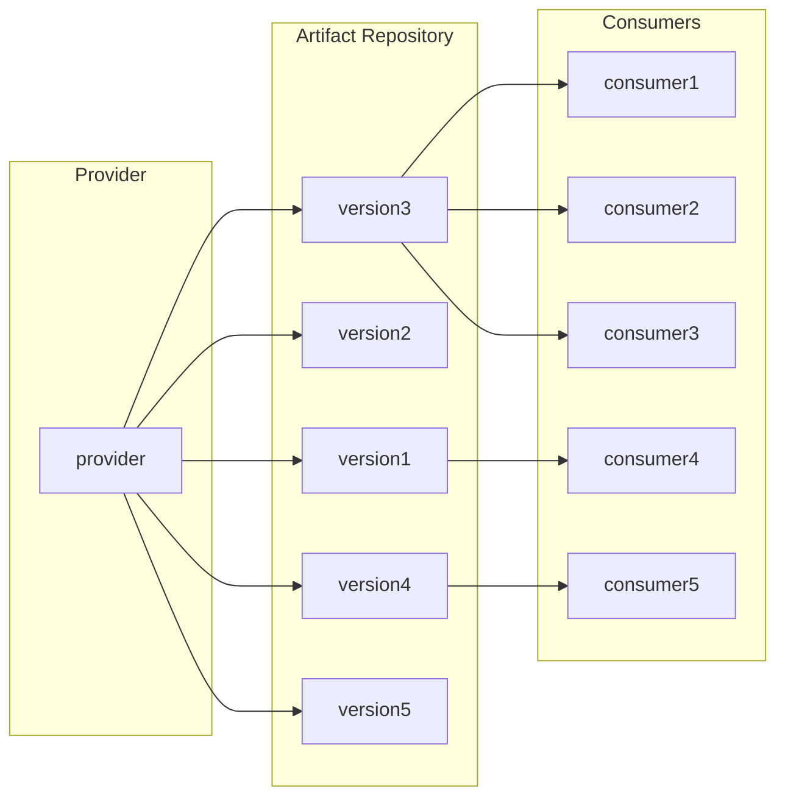
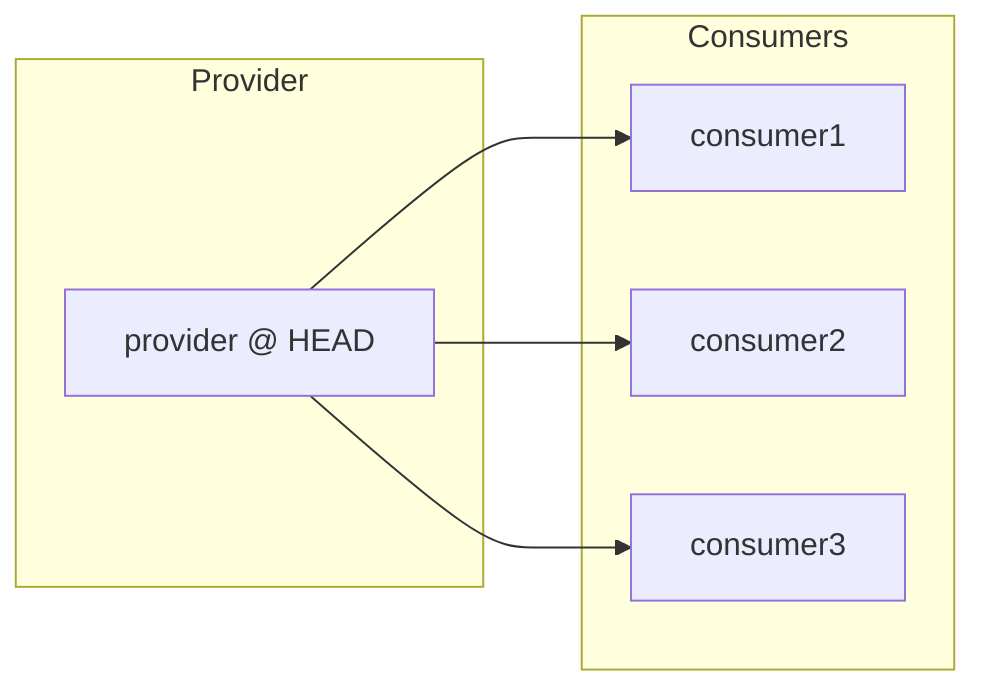

# Monorepo

Say your team owns a shared library and one of its APIs needs to change. The change itself takes an afternoon, but the library has a dozen consumers, each in its own repository. So you add the new API next to the old one and publish a release. Then you wait while each team upgrades on its own schedule, chase the ones that don't, and finally remove the old API in another release. One small idea has turned into two releases, a pile of pull requests, and months of follow-up.

Now picture the same change in a monorepo ([Wikipedia](https://en.wikipedia.org/wiki/Monorepo)): a single version-controlled repository that holds the source code for many projects, often for an entire organization. You change the API and its callers together, test everything affected, get approval from the owners, and commit. There is no package to publish and no old version to keep alive.

The catch is that someone has to do all that work in the consumers' code. Inside a company, unlike in open source, you get to decide who that is. If the library owner takes it on, a monorepo makes that practical, and versioning internal libraries becomes overhead you can drop.

This may sound counterintuitive if you come from open source, but it works well at many tech companies. Google is the most famous example, and it has been vocal about it for years. Meta, Microsoft (for Windows), Uber, and Twitter have practiced it too. This article looks at how a monorepo changes cross-project development, releases, and CI, what it costs, and where Bazel ([bazel.build](https://bazel.build)) fits in. Bazel is a monorepo-friendly, polyglot build system designed for hermetic builds, open-sourced from Blaze, Google's internal build tool.

## Repositories and versions

One project, one repository. Each project is written in one language, organized by a build system, declares its dependencies, maintains its CI pipeline, and publishes its own releases. Consumers choose which version to use and when to upgrade. For many developers, this is simply how software development works.

```
cool_project/
├── .github/
│   ├── dependabot.yml        # Automated dependency upgrades
│   └── workflows/            # The project's own CI pipeline
├── src/cool_library/         # Source code
├── tests/                    # Test suite
├── README.md
└── pyproject.toml            # Dependencies, build config, and version
```

The model feels natural because we encounter it throughout open source, where contributors are often spread across the world and loosely coordinated. Package managers teach us to consume software as independently versioned packages, while repository platforms make each project a self-contained workspace. Even so, some large open-source projects, such as LLVM, have consolidated into a monorepo.

In this model, a library owner, or provider, implements a change, assigns a version, and publishes a package. Consumers then decide when to adopt it and resolve any incompatibilities. The provider delivers a release; the consumer manages its adoption. Versions act as a wall between the two, letting different consumers sit on different states of the library. Modern artifact registries generally keep versions immutable, so a consumer can stay on an old one for years while the provider releases many new ones.



At its best, this model works well. Tools like Dependabot open upgrade pull requests automatically, each consumer's CI validates them, and routine upgrades need little attention. Each team stays in control of its own risk, and a bad release can't reach a consumer until that consumer takes it. What upgrade bots can't do is finish a breaking change: they bump the version, but someone still has to fix the code in every consumer, and that work stays spread across teams.

The repo-per-project model assumes a degree of independence between projects that is worth questioning. In an enterprise, coordination often extends across project boundaries. A shared library and its consumers may belong to different teams, but those teams work for the same organization, toward the same goals. They can negotiate priorities, agree on migration schedules, and validate changes together.

That closeness makes a choice available that open source does not have: an organization can decide who pays for a breaking change. By default, each consumer pays, which spreads one team's decision across many teams that have little reason to prioritize it. The alternative is to make the provider responsible for all of it, including the work in consumer projects. The team that wants the change understands it best, and carrying the cost gives it a reason to avoid breaking changes in the first place. This is a policy rather than a given, and the rest of this article builds on it.

This policy is hard to practice across repositories, where a provider cannot easily see, change, or test its consumers' code. A monorepo removes those obstacles, and in doing so changes what a release needs to be.

## What a monorepo unlocks

### Cross-project changes

The API change from the opening shows the main benefit: where practical, a provider can update a library and all its callers in one commit. That commit records a consistent source state for everyone involved, each part of it still goes through review, and every consumer's source moves to the new API together.

An atomic source change does not guarantee an atomic deployment. A monorepo is not a monolith: services in it are still built, deployed, and scaled independently. Services that communicate over a network may still require compatible interfaces and staged rollouts, and large migrations may span many commits. The advantage is that related source changes can be developed, reviewed, and validated together, reducing the intermediate states teams must manage.

One source tree also makes large-scale changes practical. When an API is deprecated across hundreds of callers, tools can find and rewrite every call site from one place, then split the result into reviewable chunks by owner. At Google, Rosie handles that splitting ([Potvin and Levenberg, 2016](https://cacm.acm.org/magazines/2016/7/204032-why-google-stores-billions-of-lines-of-code-in-a-single-repository/fulltext)). Multi-repo tools can do this too, but they first have to find every repository and then work with each one's build and CI setup. The same visibility lets teams find and reuse each other's work instead of rebuilding it.

A single repository does not mean anyone can change anything. Ownership is typically declared per directory, with `OWNERS` or `CODEOWNERS` files, so a cross-project change still needs approval from each affected owner. Large changes can still stall here, which is why some organizations let trusted reviewers approve mechanical changes across the whole repository. Bazel adds a build-time boundary through `visibility`: a target can only be depended on by the packages it explicitly allows.

```python
py_library(
    name = "internal_cool_lib",
    srcs = ["lib.py"],
    visibility = ["//cool_org:__subpackages__"],
)
```

Boundaries are still enforced; they just stop being repository boundaries.

### Releases without versions

Versions exist so that consumers can sit on different states of a library. When a provider updates the library and its callers in one commit, that gap never opens, so the versioning wall from earlier has little left to do. A shared library has little reason to carry versions, or to be packaged and released at all.

A packaged library is merely a handoff format between a provider and consumers who build separately. When consumers build directly from the library's source, there is nothing to hand off, and building, publishing, and hosting library packages becomes overhead. Deployable services are still built into artifacts such as binaries or container images, but shared libraries no longer need a release process of their own. The exception is code used outside the repository, such as a public SDK, which still needs packages and versions.

Every consumer now depends on the library's current source:



A consumer declares its dependencies by source path, not by version:

```python
py_library(
    name = "consumer_lib",
    srcs = ["consumer.py"],
    deps = [
        "//thirdparty/py/numpy",
        "//thirdparty/py/pandas",
        "//cool_org/internal_cool_lib",
    ],
)
```

The same principle extends to third-party code. Each external package, such as `numpy`, is vendored or pinned once for the whole repository, so every project builds against the same version. This "one-version rule" eliminates diamond-dependency conflicts, where two libraries require incompatible versions of a shared dependency. The cost is that upgrading a third-party package means upgrading it for everyone at once, so whoever does the upgrade takes on the provider's role and fixes every project it breaks.

A library change reaches production through its consumers' next routine deployment rather than through a release of its own. With continuous delivery, where each service is built from the latest source and often released several times a day, that happens quickly. On slower schedules, it takes longer. Either way, consumers give something up: they can no longer wait out a change or pin back a single library when it goes wrong. This model depends on testing consumers before a change merges.

### Shared CI

In the repo-per-project model, a project repo typically maintains its own CI pipelines for dependency setup, build, tests, and artifact publishing. Modern CI platforms offer reusable and versioned step components to avoid code duplication. As a result, CI works a lot like a regular dependency: a change to a shared CI component has to be released, and each project has to adopt it.

In addition, separate pipelines create gaps in validation. Tests of a library may pass while its changes break downstream applications. Checking those consumers requires extra coordination across repositories. Enterprises often build tooling to test consumers before a change is released, but that tooling has to work across every repository's setup, and it is one more system to maintain.

A monorepo allows shared CI infrastructure to validate related projects against the same source revision. Toolchains and policies can be maintained centrally, while affected consumers can be tested before a change merges.

As the repository grows, running every build and test becomes impractical, so dependency-aware build systems identify affected code, reuse fine-grained cached results, and execute work in parallel. For example, with Bazel, `bazel query 'rdeps(//..., //cool_org/internal_cool_lib)'` lists every target that transitively depends on a library, so CI builds and tests only those. The organization's investment shifts from maintaining many pipelines to improving shared infrastructure.

Sharing one trunk also means sharing its breakages. A bad commit to a widely used library can block every team. Monorepos therefore pair with trunk-based development: presubmit checks or a merge queue guard the trunk, unfinished features hide behind flags instead of long-lived branches, and a breaking commit is rolled back first and investigated second.

## Challenges

The biggest cost is one this model asks for on purpose. Provider-owned adoption moves migration work onto library teams, who may not know their consumers' code. It only works when consumers have tests that catch a break, and a widely used library may need migration tooling or help from consumer owners. A flaky test in someone else's project can also hold up a provider's change, so test quality becomes everyone's problem.

Version skew does not disappear either. One source revision keeps the code consistent, but production still runs whatever was deployed last, and a service that rarely deploys keeps running old library code until its next deployment.

Finally, the capacity of version control is limited. Plain Git slows down as history and file count grow. Modern Git closes much of the gap with partial clone, sparse checkout, and the built-in `scalar` command. Centralized systems such as Perforce scale by syncing only the paths a developer needs, at the cost of offline work and the Git ecosystem. The largest companies built their own: Meta's Sapling (open source) and Google's Piper (internal).

Some of these costs arrive up front, like the migration itself, while others last as long as the repository does. The benefits grow with the number of interdependent projects, so the trade-off pays off when a lot of your code changes together.

## Bazel and alternatives

If your projects are mostly JavaScript and TypeScript, [Nx](https://nx.dev/) or [Turborepo](https://turborepo.com/) will get you much of the benefit with far less setup. [Pants](https://www.pantsbuild.org/) and Meta's [Buck2](https://buck2.build/) are polyglot but have smaller ecosystems.

For repositories that span several languages, Bazel is usually the first option to evaluate, because its rules cover many languages and its caching and remote execution are built for that scale. Its best-known scale numbers come from its internal counterpart, Blaze, which was building a repository at Google containing approximately two billion lines of code in nine million source files in [2016](https://cacm.acm.org/magazines/2016/7/204032-why-google-stores-billions-of-lines-of-code-in-a-single-repository/fulltext). Blaze runs on Google's own infrastructure, though, so Bazel users have to bring their own.

Bazel's community provides rules for many languages, alongside code generation, packaging, and container builds. Bazel is designed for hermetic builds: each action sees only its declared inputs, not whatever happens to be on the machine, so the same inputs should produce the same outputs. In practice this takes some work, such as pinning toolchains instead of using whatever the host provides. With hermetic builds in place, aggressive caching is safe: Bazel reuses build outputs and test results whenever their inputs remain unchanged, sharing that work across developers and CI, and it can run the rest in parallel or on remote machines.

Here is a no-op build from a real repository. Bazel analyzed about 500k configured targets in this build's dependency graph, found all 1,102 actions in its cache, and had nothing to rebuild. Most of the elapsed time went to analysis, which a warm Bazel server skips.

```
INFO: Analyzed target //cyclopsgroup/note:note (1404 packages loaded, 506900 targets configured).
INFO: Found 1 target...
Target //cyclopsgroup/note:note up-to-date:
  bazel-bin/cyclopsgroup/note/note
INFO: Elapsed time: 25.552s, Critical Path: 0.64s
INFO: 1 process: 1102 action cache hit, 1 internal.
INFO: Build completed successfully, 1 total action
INFO: Running command line: bazel-bin/cyclopsgroup/note/note
```

Put together, a Bazel monorepo might look like this. Every project shares one CI pipeline, one Bazel version, and one set of third-party dependencies, while `BUILD.bazel` files declare each project's targets and who may depend on them:

```
company_monorepo/
├── .github/workflows/        # One shared CI pipeline for every project
├── .bazelrc                  # Shared build flags and remote cache settings
├── .bazelversion             # Pins one Bazel version for everyone
├── MODULE.bazel              # Bazel rules and toolchain dependencies
├── CODEOWNERS                # Who approves changes to each directory
├── cool_org/
│   ├── internal_cool_lib/    # Shared library
│   │   ├── BUILD.bazel       # Targets, dependencies, and visibility
│   │   ├── lib.py
│   │   └── lib_test.py
│   └── consumer_service/     # Service that depends on the library
│       ├── BUILD.bazel
│       └── consumer.py
├── cool_webapps/
│   └── web_app/              # A TypeScript project in the same repository
│       ├── BUILD.bazel
│       └── src/
├── thirdparty/
│   └── py/
│       ├── numpy/            # One pinned version for the whole repository
│       └── pandas/
└── tools/                    # Shared toolchains, linters, and code generators
```

None of this comes free. Bazel has a real learning curve. Every project needs BUILD files, rules vary in maturity across languages, and IDE integration takes work.

## Does it make sense to you?

Open source values project independence: separate repositories and immutable dependency versions let maintainers and consumers evolve on their own schedules. Enterprises have more integrated software and teams, so they can choose differently. Many keep the repo-per-project model anyway, sometimes for good reasons such as access control or tooling cost, and sometimes simply because it is the default.

A monorepo is likely worth it if many of your changes cross repository boundaries, if migrations of shared libraries drag on for months, and if your services deploy often enough for library changes to flow through. It also takes two commitments: library teams have to own adoption by their consumers, and someone has to own the build and CI infrastructure for the long term.

Migrating an existing codebase is a project in itself, so it helps to go in steps. Start with a few closely connected projects that already change together, rather than moving everything at once. Bring them in with their history where you can, move them to the shared CI and the one-version rule, and keep publishing packages for repositories that have not moved yet. Each step should pay for itself before you take the next one.

It comes back to the question from the opening: who does the work in the consumers' code? If your answer can be "the team that wants the change," a monorepo deserves a serious look.
