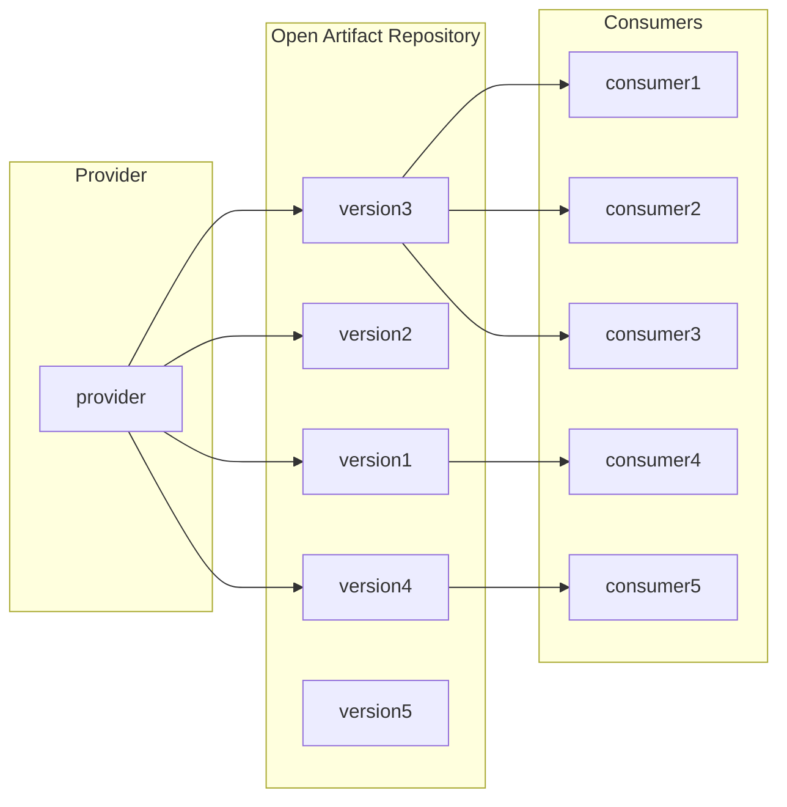

# Monorepo and Bazel

Bazel ([bazel.build](https://bazel.build)) is an open-source build system that supports polyglot and hermetic builds. It is a monorepo-friendly build system open-sourced from Google's internal build system, Blaze. Monorepo ([wikipedia:Monorepo](https://en.wikipedia.org/wiki/Monorepo)) is the idea of a single version-controlled repository that contains the source code for all projects across an entire organization, despite the way they are written, built, owned and released.

The concept of a monorepo may sound counter-intuitive in the open-source world. However, in reality it works exceedingly well in many tech companies of all sizes. The most famous example is Google, which has been vocal about it for years, while other companies such as Amazon, Meta, Microsoft, Lyft, and Stripe have practiced it for decades, some growing from it since day one, some started with it long before the existence of Git.

If you wonder how this unpopular concept fits enterprise software ecosystems, this article explores how it changes releases, CI, and cross-project development, and why Bazel is a compelling build system for monorepo to work.


## Repo per project and enterprise software

One project, one repository. Each project is written in a programming language, organized by a build system, declares its dependencies, maintains its CI pipeline, and publishes its own releases. Whoever likes it chooses a version to use and when to upgrade. Versions provide reliable reference points between projects, allowing providers to evolve their code while consumers accept changes at their own pace. For many developers, this is simply how software development works.

```
cool_project/
├── .github/                  # CI/CD workflows (e.g., GitHub Actions)
│   ├── dependabot.yml        # Dependabot configuration
│   └── workflows/            # Github actions
│       └── run_tests.yml     # Github action to run tests
├── .venv/                    # Local virtual environment (never commit!)
├── docs/                     # Project documentation
├── src/                      # Source directory root
│   └── cool_library/           # Main package (uses snake_case)
│       ├── __init__.py       # Marks directory as an importable package
│       └── __main__.py       # Code execution entry point via `python -m`
├── tests/                    # Test suite (mirrors the src/ layout)
│   └── test_core.py          # Individual module tests
├── .env.example              # Template for environment variables
├── .gitignore                # Specified files ignored by Git
├── LICENSE                   # Legal distribution terms
├── README.md                 # Project overview and quickstart instructions
└── pyproject.toml            # Unified tool configs, dependencies, and metadata
```

The model feels natural because we encounter it throughout open source where contributors are lone-wolves spread across the world. Package managers teach us to consume software as independently versioned packages, while repository platforms make each project a self-contained workspace.

The repo-per-project model assumes a degree of independence between projects worth questioning. In an enterprise, coordination often extends across project boundaries. A shared library and its consuming services
may belong to different teams, yet those teams operate closely within the same organization. They can negotiate priorities, agree on migration schedules, and validate changes together, forming a connected ecosystem serving shared business goals. Typically the project owner is responsible for all necessary work, including the work in consumer projects, to support a release.

As a result, the importance of providing a high degree of independence to project owners becomes less pronounced in an enterprise. The project boundaries are blurred, the responsibility of anything about a project is concentrated to the owner, and the need for strict versioning diminishes in favor of continuous delivery.

## The huddle of release

In the repo-per-project model, the release process typically involves a library owner implementing a change, testing it, assigning a version, and publishing a package. Consumers then decide when to adopt it, resolve incompatibilities, and validate their applications. The owner delivers a release; the consumer manages its adoption. Versions make this separation practical by allowing different consumers to depend on different states of the library.



Versioning works as a wall between provider and consumer and provides them isolation and freedom to work independently. At any given time, numerous versions co-exist to serve various consumers. With modern artifact registry platforms, versions are generally immutable. A consumer can use an old version for years while provider releases many new versions.

In an organization, versioning becomes far less meaningful. If a change is intended to improve several internal services, its value depends on those services adopting it. Responsibility of provider can therefore extend through the entire release cycle: implementation, consumer migration, integration testing, and safe rollout. The owner of the library works with the consumer teams closely to carry out the entire release process. Version becomes an ephemeral concept that only exists during the rollout. Most of the time there is only a few versions in the organization, the latest and potentially several recent ones in case of rollbacks.

A monorepo completely embraces the idea of broader reponsibility and abandons the concept of internal versioning. It allows a library and its consumers to change together, eliminating the need to publish a new version for consumers to accept a change. The integrated changes can be built and checked together, committed together and in some cases released together.


## Cross-project changes

Consider a shared library whose API needs to change, along with several consumers that use it. In repo-per-project model, this becomes a sequence of coordinated changes. The library owner introduces the new API, preserves the old one, and publishes a release. Application owners then update their dependencies and migrate their code. Once every consumer has migrated, the library owner can remove the old API and publish another release. A single conceptual change becomes multiple pull requests, releases, and handoffs. Chances are some consumers don't bother the change and continue to depend on the version before the change. Now both old and new version of the project must co-exist for a long time.

In a monorepo, the library and its consumers can be updated in one change if reasonable. The developer modifies the API, updates its callers, and runs the relevant tests across affected projects. Each part of the change still requires proper review and approval but after that, one commit can record a consistent source state for all involved parties. For internal dependencies, there is no need to publish an intermediate package merely to make the updated API available to consumers.

Note that an atomic source change does not guarantee an atomic deployment. Services that communicate over a network may still require compatible interfaces and staged rollouts, and large migrations may span many commits. The advantage is that related source changes can be developed, reviewed, and validated together, reducing the intermediate states teams must manage.


## CI in organization

In repo-per-project model, a project repo typically maintains its own CI pipeline for dependency setup, build, tests, and artifact publishing. Modern CI platforms offer reusable and versioned steps to avoid code duplication. As a result, CI works a lot like a regular dependency. Therefore the same release huddle of dependencies applies to CI pipelines across projects in an organization.

In addition, separate pipelines also create gaps in validation. Tests of a library may pass while its changes break downstream applications. Checking those consumers requires additional coordination across repositories. Enterprise often develop additional solution to allow cross-project testing before changes are released, while these solutions can be costly to maintain and hard to use.

A monorepo allows shared CI infrastructure to validate related projects against the same source revision. Toolchains and policies can be maintained centrally, while affected consumers can be tested before a change merges. As the repository grows, running every build and test becomes impractical, so monorepo tools provide dependency-aware build systems to identify affected code, reuse fine-grained cached results, and execute work in parallel. The organization’s investment shifts from maintaining many pipelines to improving shared infrastructure.

## Monorepo changes the story

Purpose: Consolidate the argument before introducing tooling.
Concern	Project per repository	Integrated monorepo
Primary coordination unit	Project release	Change across affected projects
Internal dependencies	Commonly consumed as versioned packages	Can be consumed directly from shared source
Integration feedback	Often arrives during downstream adoption	Can arrive before merge
Cross-project refactoring	Multiple changes and release steps	Can be one coordinated source change
Build configuration	Distributed across repositories	Shared conventions with project-level declarations
Ownership	Often reinforced by repository boundaries	Expressed through directories, review rules, and visibility
Deployment	Independent where required	Still independent where required
Main infrastructure challenge	Consistency across repositories	Efficient validation and governance at scale


Close this section with the requirement that follows: the build system must understand dependencies across the repository.

## Bazel and alternative

Purpose: Connect Bazel’s design directly to the problems established earlier.
- Introduce targets, BUILD files, rules, and the dependency graph.
- Explain how explicit dependencies support incremental execution and impact analysis.
- Show how controlled build inputs make cached results more trustworthy.
- Explain remote caching and remote execution: reuse completed work and distribute remaining build and test actions. Bazel supports both through its remote infrastructure interfaces. bazel.build
- Connect these capabilities to the running example: validate the library change and relevant consumers without rebuilding everything.
Briefly compare alternatives:
- Buck2: a serious alternative designed for large monorepos.
- Pants: another scalable monorepo build system worth evaluating.
- Nx and Turborepo: relevant comparisons for repositories organized around application and package tasks.
- Existing language-specific tools: may be sufficient for a narrower, more homogeneous ecosystem.
Frame “why Bazel wins” as the article’s reasoned conclusion:

For a large, multilingual enterprise ecosystem that prioritizes explicit dependencies, reproducible builds, shared caching, and distributed execution, argue that Bazel offers a compelling combination. Balance that conclusion against migration effort, rule maintenance, and developer training. Buck2 and Pants are credible competitors, so avoid claiming an unconditional technical victory.

## Design to deliver 

Return to the shared-library example.
Independent ecosystems benefit from explicit publication and adoption boundaries.
Closely connected enterprise teams can benefit from managing source changes and validation together.
A monorepo provides the shared workspace; Bazel provides a build model that can make it practical at scale.
End on the organizational outcome: teams can take responsibility for a change across the software ecosystem, from implementation through safe adoption.
