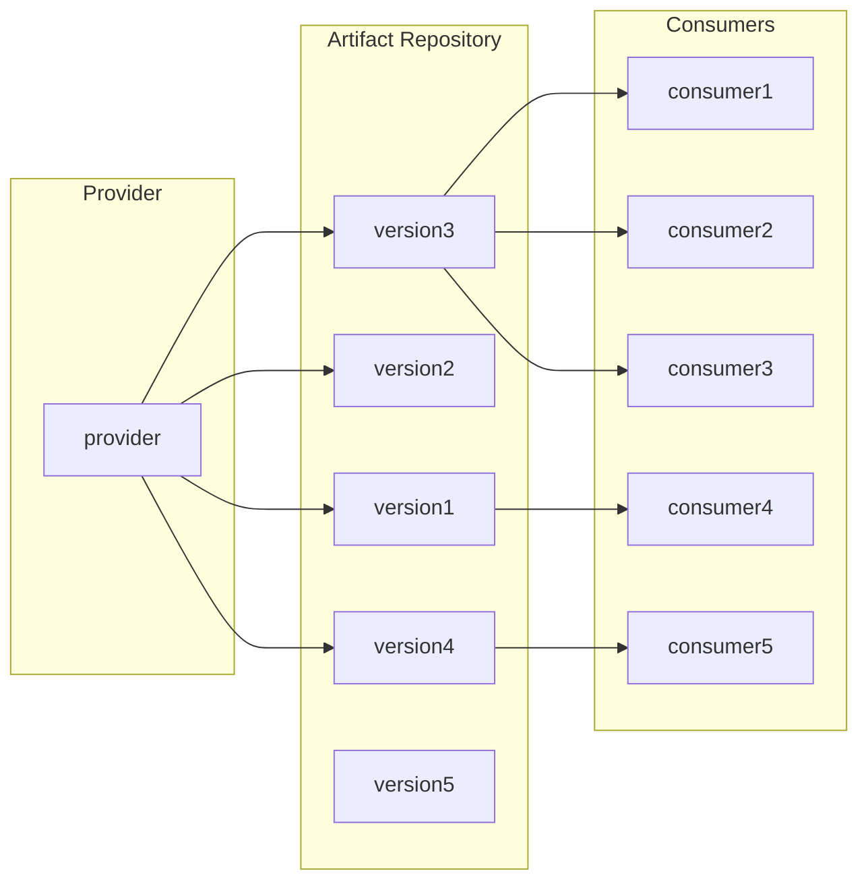
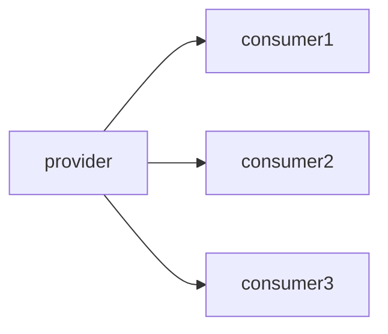

# Monorepo and Bazel

Monorepo ([wikipedia:Monorepo](https://en.wikipedia.org/wiki/Monorepo)) is the idea of a single version-controlled repository that contains the source code for all projects across an entire organization, regardless of how they are written, built, owned, or released. Bazel ([bazel.build](https://bazel.build)) is a monorepo-friendly, polyglot build system with hermetic builds, open-sourced from Blaze, Google's internal build tool.

The concept of a monorepo may sound counter-intuitive in the open-source world. However, in reality it works well at many tech companies, large and small. The most famous example is Google, which has been vocal about it for years, while other companies such as Meta, Microsoft (for Windows), Uber, and Twitter have long practiced it, some since day one, others since long before Git existed.

If you wonder how the monorepo concept fits enterprise software ecosystems, this article explores how it changes releases, CI, and cross-project development, what it costs, and why Bazel is a compelling build system for making a monorepo work.


## Repo-per-project and enterprise software

One project, one repository. Each project is written in a programming language, organized by a build system, declares its dependencies, maintains its CI pipeline, and publishes its own releases. Consumers choose which version to use and when to upgrade. Versions provide reliable reference points between projects, allowing providers to evolve their code while consumers accept changes at their own pace. For many developers, this is simply how software development works.

```
cool_project/
├── .github/                  # CI/CD workflows (e.g., GitHub Actions)
│   ├── dependabot.yml        # Dependabot configuration
│   └── workflows/            # GitHub Actions
│       └── run_tests.yml     # GitHub Action to run tests
├── .venv/                    # Local virtual environment (never commit!)
├── docs/                     # Project documentation
├── src/                      # Source directory root
│   └── cool_library/         # Main package (uses snake_case)
│       ├── __init__.py       # Marks directory as an importable package
│       └── __main__.py       # Code execution entry point via `python -m`
├── tests/                    # Test suite (mirrors the src/ layout)
│   └── test_core.py          # Individual module tests
├── .env.example              # Template for environment variables
├── .gitignore                # Files ignored by Git
├── LICENSE                   # Legal distribution terms
├── README.md                 # Project overview and quickstart instructions
└── pyproject.toml            # Unified tool configs, dependencies, and metadata
```

The model feels natural because we encounter it throughout open source, where contributors are often spread across the world and loosely coordinated. Package managers teach us to consume software as independently versioned packages, while repository platforms make each project a self-contained workspace. Even so, some large open-source projects, such as LLVM, have consolidated into a monorepo.

The repo-per-project model assumes a degree of independence between projects worth questioning. In an enterprise, coordination often extends across project boundaries. A shared library and its consuming services may belong to different teams, yet those teams operate closely within the same organization. They can negotiate priorities, agree on migration schedules, and validate changes together, forming a connected ecosystem serving shared business goals. The project owner is often responsible for all necessary work, including the work in consumer projects, to support a release.

As a result, the importance of providing a high degree of independence to project owners becomes less pronounced in an enterprise. Repository boundaries matter less, responsibility for a project's full lifecycle falls on its owner, and the need for strict versioning diminishes in favor of continuous delivery.

## The hurdle of release

In the repo-per-project model, the release process typically involves a library owner implementing a change, testing it, assigning a version, and publishing a package. Consumers then decide when to adopt it, resolve incompatibilities, and validate their applications. The owner delivers a release; the consumer manages its adoption. Versions make this separation practical by allowing different consumers to depend on different states of the library.



Artifact versioning works as a wall between provider and consumer and provides them isolation and freedom to work independently. At any given time, numerous versions co-exist to serve various consumers. With modern artifact registry platforms, versions are generally immutable. A consumer can use an old version for years while the provider releases many new versions.

In an organization, artifact versioning becomes far less meaningful. If a change is intended to improve several internal services, its value depends on those services adopting it. The provider's responsibility can therefore extend through the entire release cycle: implementation, consumer migration, integration testing, and safe rollout. The owner of the library works with the consumer teams closely to carry out the entire release process. A version becomes an ephemeral concept that only exists during the rollout. Most of the time there are only a few versions in the organization, the latest and potentially several recent ones in case of rollbacks.

A monorepo completely embraces the idea of broader responsibility and abandons the concept of internal library versioning. It allows a library and its consumers to change together, eliminating the need to publish a new version for consumers to accept a change. The integrated changes can be built and checked together, committed together, and in some cases released together. With all code visible in one place, teams can also find and reuse each other's work instead of rebuilding it.

A consumer declares its dependencies by source path, not by version:

```python
py_library(
    name = "consumer_lib",
    srcs = ["consumer.py"],
    deps = [
      "//thirdparty/py/numpy",
      "//thirdparty/py/pandas",
      "//cool_org/internal_cool_lib",
    ]
)
```

The same principle extends to third-party code. Each external package, such as `numpy`, is vendored or pinned once for the whole repository, so every project builds against the same version. This "one-version rule" eliminates diamond-dependency conflicts, where two libraries require incompatible versions of a shared dependency. The cost is that upgrading a third-party package means upgrading it for everyone at once, which is exactly the provider-owns-adoption model described above.



## Cross-project changes

Consider a shared library whose API needs to change, along with several consumers that use it. In the repo-per-project model, this becomes a sequence of coordinated changes. The library owner introduces the new API, preserves the old one, and publishes a release. Application owners then update their dependencies and migrate their code. Once every consumer has migrated, the library owner can remove the old API and publish another release. A single conceptual change becomes multiple pull requests, releases, and handoffs. Chances are some consumers never bother to migrate and continue to depend on the version before the change. Now both old and new versions of the project must co-exist for a long time.

In a monorepo, the library and its consumers can be updated in one change where practical. The developer modifies the API, updates its callers, and runs the relevant tests across affected projects. Each part of the change still requires proper review and approval, but after that, one commit can record a consistent source state for all involved parties. For internal dependencies, there is no need to publish an intermediate package merely to make the updated API available to consumers.

Note that an atomic source change does not guarantee an atomic deployment. A monorepo is not a monolith: services in it are still built, deployed, and scaled independently. Services that communicate over a network may still require compatible interfaces and staged rollouts, and large migrations may span many commits. The advantage is that related source changes can be developed, reviewed, and validated together, reducing the intermediate states teams must manage.

The same property enables large-scale changes. When an API is deprecated across hundreds of callers, a tool can rewrite every call site and split the result into reviewable chunks by owner. Google's Rosie is an example ([Potvin and Levenberg, 2016](https://cacm.acm.org/magazines/2016/7/204032-why-google-stores-billions-of-lines-of-code-in-a-single-repository/fulltext)). In a multi-repo world, the same migration means tracking down every repository and waiting on every team.

A single repository does not mean anyone can change anything. Ownership is typically declared per directory, with `OWNERS` or `CODEOWNERS` files, so a cross-project change still needs approval from each affected owner. Bazel adds a build-time boundary through `visibility`: a target can only be depended on by the packages it explicitly allows.

```python
py_library(
    name = "internal_cool_lib",
    srcs = ["lib.py"],
    visibility = ["//cool_org:__subpackages__"],
)
```

Boundaries are still enforced; they just stop being repository boundaries.


## CI across an organization

In the repo-per-project model, a project repo typically maintains its own CI pipelines for dependency setup, build, tests, and artifact publishing. Modern CI platforms offer reusable and versioned step components to avoid code duplication. As a result, CI works a lot like a regular dependency. Therefore, the same release hurdle applies to CI pipelines across projects in an organization.

In addition, separate pipelines create gaps in validation. Tests of a library may pass while its changes break downstream applications. Checking those consumers requires additional coordination across repositories. Enterprises often build additional tooling to allow cross-project testing before changes are released, while these solutions can be costly to maintain and hard to use.

A monorepo allows shared CI infrastructure to validate related projects against the same source revision. Toolchains and policies can be maintained centrally, while affected consumers can be tested before a change merges. As the repository grows, running every build and test becomes impractical, so monorepo tools provide dependency-aware build systems to identify affected code, reuse fine-grained cached results, and execute work in parallel. For example, with Bazel, `bazel query 'rdeps(//..., //cool_org/internal_cool_lib)'` lists every target that transitively depends on a library, so CI builds and tests only those. The organization’s investment shifts from maintaining many pipelines to improving shared infrastructure.

A build in a repository with ~500k configured targets: 1,102 actions were reused from cache, and only one actually ran. Most of the elapsed time went to analysis, which a warm Bazel server skips.

```
======================================================================
INFO: Analyzed target //cyclopsgroup/note:note (1404 packages loaded, 506900 targets configured).
INFO: Found 1 target...
Target //cyclopsgroup/note:note up-to-date:
  bazel-bin/cyclopsgroup/note/note
INFO: Elapsed time: 25.552s, Critical Path: 0.64s
INFO: 1 process: 1102 action cache hit, 1 internal.
INFO: Build completed successfully, 1 total action
INFO: Running command line: bazel-bin/cyclopsgroup/note/note

```

Sharing one trunk also means sharing its breakages. A bad commit to a widely used library can block every team. Monorepos therefore pair with trunk-based development: changes are tested before merging (presubmit checks or a merge queue), unfinished features hide behind flags instead of long-lived branches, and a breaking commit is rolled back first and investigated second.

## Bazel and alternatives

Popular monorepo build systems include [Nx](https://nx.dev/), [Turborepo](https://turborepo.com/), [Pants](https://www.pantsbuild.org/), and Meta’s [Buck2](https://buck2.build/). For multilingual enterprises of all sizes, Bazel offers a great combination of proven scale, language support, and build infrastructure. Nx and Turborepo focus primarily on JavaScript and TypeScript, while Pants and Buck2 are polyglot but have smaller ecosystems. Bazel’s internal counterpart, Blaze, builds a repository at Google containing approximately two billion lines of code in nine million source files as of [2016](https://cacm.acm.org/magazines/2016/7/204032-why-google-stores-billions-of-lines-of-code-in-a-single-repository/fulltext).

Bazel’s community provides rules for many languages, alongside code generation, packaging, and container builds. Builds are hermetic: each action sees only its declared inputs, not whatever happens to be on the machine, so the same inputs should produce the same outputs. That is what makes its aggressive caching safe: it reuses build outputs and test results whenever their inputs remain unchanged, sharing that work across developers and CI. Remote caching integrates directly with Google Cloud Storage and supports Amazon S3 through cache servers such as bazel-remote. Combined with parallel and remote execution, these capabilities make Bazel a compelling foundation for enterprise development at scale.

Put together, a Bazel monorepo might look like this. Every project shares one CI pipeline, one Bazel version, and one set of third-party dependencies, while `BUILD.bazel` files declare each project's targets and who may depend on them:

```
company_monorepo/
├── .github/workflows/        # One shared CI pipeline for every project
├── .bazelrc                  # Shared build flags and remote cache settings
├── .bazelversion             # Pins one Bazel version for everyone
├── MODULE.bazel              # Repository-wide external dependencies
├── cool_org/
│   ├── internal_cool_lib/    # Shared library
│   │   ├── BUILD.bazel       # Targets, dependencies, and visibility
│   │   ├── lib.py
│   │   └── lib_test.py
│   └── consumer_service/     # Service that depends on the library
│       ├── BUILD.bazel
│       └── consumer.py
├── cool_webapps/
│   └── web_app/              # A TypeScript project in the same repository
│       ├── BUILD.bazel
│       └── src/
├── thirdparty/
│   └── py/
│       ├── numpy/            # One pinned version for the whole repository
│       └── pandas/
└── tools/                    # Shared toolchains, linters, and code generators
```

## Challenges

- **Version control at scale.** Plain Git slows down as history and file count grow. Modern Git closes much of the gap with partial clone, sparse checkout, and the built-in `scalar` command. Centralized systems such as Perforce scale by syncing only the paths a developer needs, at the cost of offline work and the Git ecosystem. The largest companies built their own: Meta's Sapling (open source) and Google's Piper (internal).
- **Build tooling.** Bazel has a real learning curve. Every project needs BUILD files, rules vary in maturity across languages, and IDE integration takes work. Migrating an existing codebase is a project in itself.
- **Access control.** Repository-level permissions no longer separate sensitive code, so organizations need per-directory controls or keep a few repositories outside the monorepo.
- **Shared infrastructure.** Someone has to own the build, CI, and caching infrastructure. Without that investment, a monorepo gets slower than the repositories it replaced.

These costs are front-loaded, while the benefits compound as the number of interdependent projects grows.

## Summary

Open source values project independence: separate repositories and immutable dependency versions let maintainers and consumers evolve on their own schedules. Enterprises have more integrated software and teams, making independent releases and per-library versioning less essential. Many keep the repo-per-project model anyway, sometimes for good reasons such as access control or tooling cost, and sometimes simply because it is the default.

For closely connected enterprise projects, a monorepo better supports coordinated changes, shared CI, and provider ownership through consumer adoption—an approach proven at major technology companies. Bazel’s mature rules ecosystem and scalable build infrastructure make it a strong choice for large polyglot repositories, provided the organization is willing to invest in that infrastructure.
